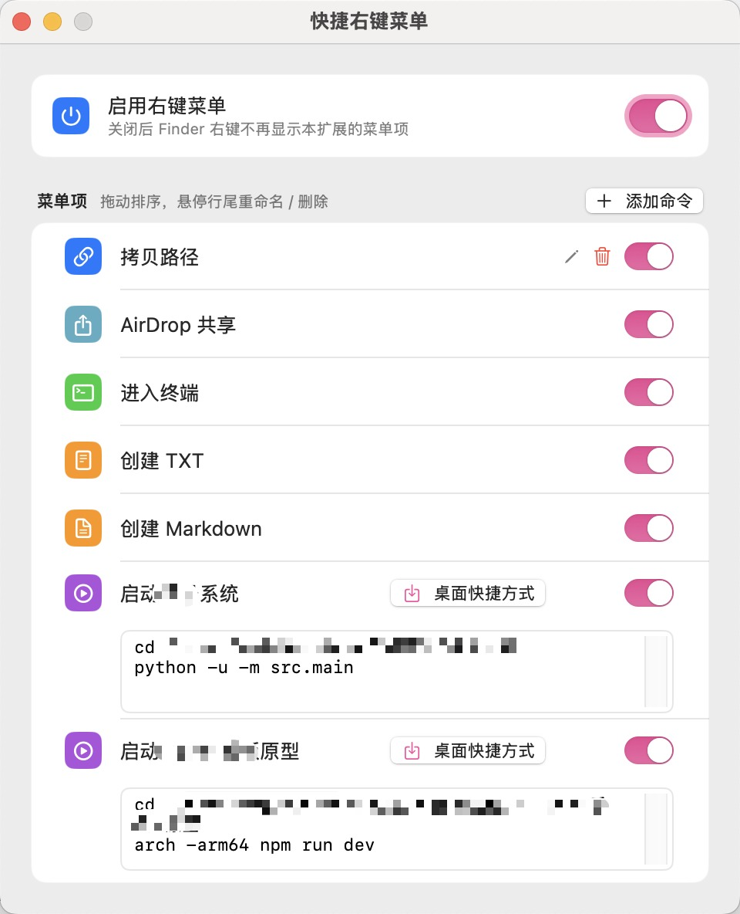
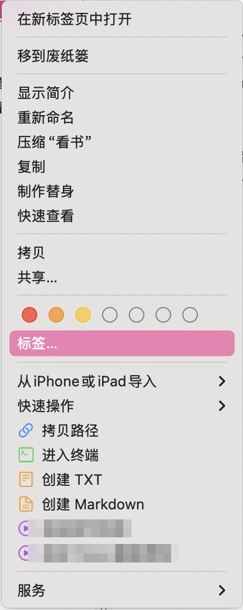

# QuickRightClick

> 可配置的 macOS Finder 右键菜单扩展：拷贝路径、AirDrop 分享、进入终端、新建文件、一键跑项目命令。
>
> A configurable Finder context-menu extension for macOS, with a native settings UI.


Finder 自带的右键菜单只有固定的几项，改不动。本项目在右键菜单里注入一组**可自由增删、排序、改名**的菜单项，
配置存在一个 JSON 文件里，改完立即生效，不需要重启 Finder。

## 截图

<p>
  
  
</p>


---

## 功能

| 菜单项 | 行为 |
|---|---|
| 拷贝路径 | 选中一个文件时复制绝对路径；多选时每行一个；右键空白处复制当前目录 |
| AirDrop 共享 | 把选中项交给系统 AirDrop 发送（未选中文件时不显示该项） |
| 进入终端 | 在选中项所在目录打开终端 |
| 创建 TXT | 新建 `新建文本文档.txt`，重名自动追加序号，随后选中该文件 |
| 创建 Markdown | 新建 `新建 Markdown.md`，规则同上 |
| 运行命令 | 在终端里新开窗口执行一段自定义命令（如 `cd ~/项目 && npm run dev`），可为它在桌面生成双击即用的启动脚本 |

菜单项都可以在设置界面里独立开关、重命名、拖拽排序、删除；运行命令项可以随意新增。

**设置界面**使用系统原生控件与配色（对齐 macOS 系统设置的分组卡片样式），窗口高度随菜单项数量自适应，没有滚动条。

---

## 环境要求

- macOS 13 Ventura 或更新版本
- Xcode 15 或更新版本（含命令行工具）
- 一个 Apple ID，免费账号即可

> Finder 扩展必须由受信任的证书签名，**ad-hoc 签名无法被系统加载**。这是系统的硬性限制，不是本项目的选择。

---

## 一键安装

```bash
git clone https://github.com/<your-name>/QuickRightClick.git
cd QuickRightClick
./install.sh
```

`install.sh` 会依次完成：

1. 从钥匙串里自动识别你的 `Apple Development` 证书（也可以手动传入团队 ID：`./install.sh ABCDE12345`）
2. Release 构建（产物在 `build/`）
3. 安装到 `/Applications/QuickRightClick.app`
4. 注册并启用 Finder 扩展
5. 重启 Finder，打开设置窗口

如果你的账号还没在 Xcode 里登录过，先做一次：**Xcode → Settings → Accounts → 添加 Apple ID**，再运行脚本。

<details>
<summary>或者用 Xcode 手动安装</summary>

1. 打开 `QuickRightClick.xcodeproj`
2. 选中 **QuickRightClick** target → **Signing & Capabilities** → 勾选 *Automatically manage signing*，Team 选你的账号
3. 对 **QuickRightClickExtension** target 重复第 2 步（两个 target 必须同一个 Team）
4. scheme 选 **QuickRightClick**（不是 Extension），按 `⌘R`
5. 双击项目根目录的 `enable-extension.command`，完成注册、启用、重启 Finder

首次运行时若被 Gatekeeper 拦截：右键 App → 打开。

</details>

### 之后每次改完代码

```bash
./install.sh     # 重新构建、安装、重启 Finder
```

只改设置界面（主程序）的话，`⌘R` 后重开应用即可；**改了扩展代码必须重启 Finder**，否则加载的还是旧进程：

```bash
killall Finder
```

---

## 使用

1. 在 Finder 里选中文件（或直接在文件夹空白处）点右键
2. 菜单底部会出现本扩展的菜单项，带彩色图标
3. 打开 App 图标即可调整：启用/停用某项、双击标题或点行尾铅笔重命名、拖拽排序、点行尾垃圾桶删除、`添加命令` 新增一条运行命令

设置界面里没有"保存"按钮——每次改动都会合并写盘（300 ms 防抖），退出前也会强制落盘。

---

## 配置

配置文件（扩展与主程序共用同一份，扩展侧带进程内缓存，文件改动会自动失效）：

```
~/Library/Application Support/QuickRightClick/config.json
```

```json
{
  "isEnabled": true,
  "schemaVersion": 2,
  "terminalBundleIdentifier": "",
  "items": [
    {
      "id": "11111111-1111-1111-1111-111111111111",
      "kind": "copyPath",
      "isEnabled": true,
      "title": "拷贝路径",
      "symbolName": "link",
      "fileSuffix": "",
      "baseName": "",
      "command": ""
    }
  ]
}
```

| 字段 | 说明 |
|---|---|
| `isEnabled` | 总开关，关闭后扩展返回空菜单 |
| `schemaVersion` | 配置结构版本，升级时用于补上新增的内置菜单项（只补一次，不会复活你删掉的项） |
| `terminalBundleIdentifier` | 「进入终端」「运行命令」使用的终端，留空 = 系统终端。目前只能改配置文件 |
| `items[].kind` | `copyPath` / `shareAirDrop` / `openTerminal` / `newFile` / `runCommand` |
| `items[].symbolName` | SF Symbols 名称，填错会回退到该类型的默认图标 |
| `items[].fileSuffix` / `baseName` | 仅 `newFile`：扩展名与基础文件名 |
| `items[].command` | 仅 `runCommand`：要执行的命令，可多行，第一行通常是 `cd` |

想恢复出厂设置：退出 App，删除上面的 `config.json`（以及同目录的 `config.json.bak`，如果有），重新打开 App。

---

## 权限与沙盒

FinderSync 扩展的运行环境比普通应用严格，本项目用到的声明如下：

| 权限 | 谁需要 | 用途 |
|---|---|---|
| `com.apple.security.app-sandbox` | 扩展 | **硬性要求**，扩展不开沙盒系统不会加载 |
| `temporary-exception.files.home-relative-path.read-write` | 扩展 | 新建文件。扩展的沙盒**不随监控目录授予写权限**，只能靠临时例外开放，范围限定在主目录 |

主程序**不开沙盒**，因此可以写入扩展容器外的配置、生成不带隔离标记的运行脚本。

读写剪贴板、启动其他应用在扩展沙盒内本来就被允许，不需要额外声明。

### 为什么 AirDrop 要绕一圈

沙盒里的 Finder 扩展既读不到任意路径的文件内容，`NSSharingService` 也不可靠。所以 AirDrop 与「运行命令」走同一条链路：

```
扩展（沙盒）--quickrightclick://airdrop?path=…--> 主程序（无沙盒）--NSSharingService--> 系统 AirDrop 面板
```

扩展只负责拼 URL，真正的分享动作交给无沙盒的主程序执行。

---

## 架构

```
QuickRightClick.app
├── Contents/MacOS/QuickRightClick              主程序：SwiftUI 设置界面 + 委托执行
└── Contents/PlugIns/
    └── QuickRightClickExtension.appex          Finder 扩展：构建 NSMenu
```

| 文件 | 职责 |
|---|---|
| `Shared/MenuConfiguration.swift` | 配置数据结构、默认项、结构版本迁移 |
| `Shared/ConfigurationStore.swift` | 配置读写（真实主目录，不在容器里，重装不丢） |
| `Shared/MenuActionExecutor.swift` | 各动作实现，含 AirDrop 委托 URL 的构造与解析 |
| `Extension/FinderSyncExtension.swift` | `menu(for:)` 回调：按配置构建菜单；配置读取走进程内缓存 |
| `App/QuickRightClickApp.swift` | 处理 `quickrightclick://` 委托：AirDrop 分享、运行命令 |
| `App/SettingsModel.swift` | 界面状态：防抖写盘、配置迁移、菜单项增删改排序 |
| `App/SettingsView.swift` | 设置界面 |
| `App/QuickRightClickTests.swift` | 单元测试（配置编解码、迁移、路径去重、命令规范化、AirDrop URL 等） |

两个 target 的沙盒状态不同：扩展必须开沙盒，主程序不开。配置因此放在真实主目录而不是扩展容器里——
容器会随 App 重新部署被清空，配置放在那里会丢。

---

## 自定义与二次开发

### 添加一种新的菜单项

1. `MenuActionKind` 加一个 case，并在 `defaultColor` / `symbolFallback` 里给它配色和默认图标
2. `MenuActionExecutor.perform` 的 switch 里加分支（需要沙盒外权限的动作，仿照 `shareAirDrop` 走 URL 委托）
3. `MenuConfiguration.defaultItems` 里加默认项
4. **递增 `MenuConfiguration.currentSchemaVersion`**，并在 `migratedToCurrentSchema()` 里补上缺省项

第 4 步容易漏：老用户的配置文件里没有新项，不补的话新功能在他们那里"看起来没生效"。
版本号保证只补一次，用户后来主动删掉的项不会被重新塞回来。

### 构建与测试

```bash
# 修改文件结构后重新生成工程（工程文件是脚本生成的）
python3 generate_project.py

# 无签名编译（CI / 本地快速验证）
xcodebuild -project QuickRightClick.xcodeproj -scheme QuickRightClick \
  -configuration Debug -derivedDataPath /tmp/qrc \
  CODE_SIGN_IDENTITY="-" CODE_SIGNING_REQUIRED=NO CODE_SIGNING_ALLOWED=NO build

# 跑测试
xcodebuild -project QuickRightClick.xcodeproj -scheme QuickRightClick \
  -configuration Debug -derivedDataPath /tmp/qrc \
  CODE_SIGN_IDENTITY="-" CODE_SIGNING_REQUIRED=NO CODE_SIGNING_ALLOWED=NO test
```

`generate_project.py` 只是工程生成器，不是构建步骤。日常改源码直接在 Xcode 里改即可，
只有增删源文件后才需要重跑（`ASSETCATALOG_COMPILER_APPICON_NAME` 等构建设置也登记在里面）。

---

## 故障排查

**右键菜单里没有我的菜单项**

```bash
# 1. 扩展是否注册且启用（行首是 + 才算启用）
pluginkit -m -v -p com.apple.FinderSync | grep QuickRightClick

# 2. 签名是否为真实证书（应显示 Apple Development，而不是 adhoc）
codesign -dv /Applications/QuickRightClick.app

# 3. 重启 Finder 让扩展重新加载
killall Finder
```

**系统设置里找不到这个扩展**

**系统设置 → 通用 → 登录项与扩展 → 文件提供程序**（不是「Finder」那一节，那里管的是快速操作）。

**改了代码但行为没变**

系统里可能注册了多个同 bundle id 的副本（比如 Xcode 的 DerivedData 里的旧构建）。
查路径并注销多余的那个，再重启 Finder：

```bash
pluginkit -m -v -i com.local.QuickRightClick.Extension      # 看 Path 列
pluginkit -r "/path/to/old/QuickRightClickExtension.appex"
pluginkit -a "/Applications/QuickRightClick.app/Contents/PlugIns/QuickRightClickExtension.appex"
pluginkit -e use -i com.local.QuickRightClick.Extension
killall Finder
```

**菜单里看不到 AirDrop**

AirDrop 只在**选中文件**时出现；在文件夹空白处右键不会显示（共享一个目录没有意义）。

**点了 AirDrop 没有反应**

确认主程序能正常启动（`open -a /Applications/QuickRightClick.app`），并查看 Console 里的
`QuickRightClick` 日志。

**免费账号用着用着失效了**

免费 Personal Team 签发的 App **7 天过期**。重新执行 `./install.sh` 即可续期。

**在 `/Applications` 或外接磁盘里右键，创建文件失败**

扩展的写权限被限定在主目录内（见上文权限说明），这是系统沙盒的限制。

---

## 已知限制

- **iCloud Drive 里不显示菜单。** FinderSync 默认只在本地卷生效；要支持需要依赖未公开的修饰位常量，系统更新可能失效。
- **只在主目录及子目录出现菜单。** 监控范围被限定为用户主目录。
- **系统不会自动启用扩展。** macOS 的已知问题：首次安装后需要手动启用一次（`install.sh` 会尝试自动完成）。
- **新建文件后只会选中该文件**，不会自动进入重命名状态（那需要额外申请「自动化」权限，收益不值得）。
- **修改主程序的 bundle id 后需要同步修改扩展 id。** 两者必须保持 `<主程序 id>.Extension` 的从属关系，否则系统不会加载扩展。

---

## 卸载

```bash
osascript -e 'quit app "QuickRightClick"'
pluginkit -r "/Applications/QuickRightClick.app/Contents/PlugIns/QuickRightClickExtension.appex"
killall Finder
rm -rf /Applications/QuickRightClick.app
rm -rf ~/Library/Application\ Support/QuickRightClick
```

---

## 隐私

- **不联网。** 没有任何网络请求、没有统计/埋点 SDK。
- **不上传任何数据。** 配置只写在本机的 `~/Library/Application Support/QuickRightClick/config.json`。
- **不读取无关文件。** 扩展只会拿到你在 Finder 里右键选中的路径；新建文件写入主目录。
- 仓库内不含任何个人信息、签名证书或团队 ID（`DEVELOPMENT_TEAM` 为空，由使用者自己的证书填充）。

---

## 贡献

欢迎提 Issue / PR。提交前请确认：

```bash
xcodebuild -project QuickRightClick.xcodeproj -scheme QuickRightClick \
  -configuration Debug -derivedDataPath /tmp/qrc \
  CODE_SIGN_IDENTITY="-" CODE_SIGNING_REQUIRED=NO CODE_SIGNING_ALLOWED=NO test
```

全部测试通过即可。涉及新增菜单项的改动，记得按上文递增 `schemaVersion`。

## License

[MIT](LICENSE) © 2026 QuickRightClick contributors
